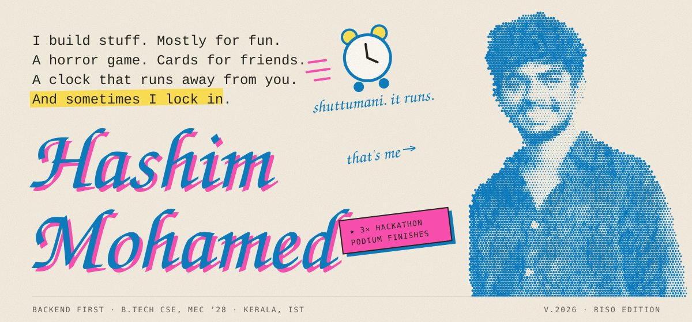

<a href="https://hashimweb.netlify.app">
  <picture>
    <source media="(prefers-color-scheme: dark)" srcset="https://raw.githubusercontent.com/justhashim/justhashim/main/assets/banner-lockin.svg">
    <source media="(prefers-color-scheme: light)" srcset="https://raw.githubusercontent.com/justhashim/justhashim/main/assets/banner-play.svg">
    
  </picture>
</a>

  <samp>
    <a href="https://hashimweb.netlify.app">portfolio</a> .
    <a href="https://hashimmohamedta.medium.com/">medium</a> .
    <a href="https://www.linkedin.com/in/hashimmohamedta/">linkedin</a> .
    <a href="https://www.instagram.com/ha._shim_/">instagram</a> .
    <a href="https://hashimweb.netlify.app/Hashim%20Mohamed%20T.A%20-%20Resume.pdf">résumé</a>
  </samp>
   
  Light theme is play mode. Switch GitHub to dark to lock in.

I goof off about 90% of the time. The other 10%, I'm locked in.

Locked in usually means backend. I interned at Linsys Innovations writing Java and Spring Boot. On my own stuff it's Node, Fastify or Python, and Postgres pretty much every time.

I'm doing a B.Tech in Computer Science at Model Engineering College, graduating in '28.

Do I always know what I'm doing? Not really. Hasn't stopped me yet.

## The serious ones

- **[rolecall](https://github.com/justhashim/rolecall)**: a job-matching agent that searches a live jobs index, using hybrid search on Postgres and pgvector. The model isn't allowed to recommend a job it never actually retrieved. If it tries, the answer gets sent back with the reason and it has to fix it. There are retrieval evals too, so I'm not just eyeballing search quality.
- **[BrightLoop](https://github.com/justhashim/BrightLoop)**: subscription billing. The one rule was never charge anyone twice, so there's a unique index on `(subscription_id, period_index)`. Run billing again and the database refuses the duplicates.
- **[STVE](https://github.com/justhashim/STVE)**: scores readings from IoT soil sensors so you know which ones to trust (`0.3 temporal + 0.5 cross + 0.2 physical`). If one probe drifts and its neighbours don't, it's probably broken and gets a ticket. If the whole zone moves together, that's a `FIELD_EVENT`, and the field really did change.
- **[Tetherverse](https://github.com/justhashim/Tetherverse-Frontend)**: a physics game where you swing and climb. Hold to grapple, let go to launch. The server keeps score, since the client can't be trusted. [Play it](https://tetherverse.vercel.app).
- **[StoryWeave](https://github.com/justhashim/StoryWeave)**: people write a story together in real time, and every fifth line GPT-2 throws in a plot twist. It won Grab A Pi Hacknight. The prize was a Raspberry Pi 4.

## The fun ones

- **[Shuttumani](https://github.com/justhashim/shuttumani)**: an alarm clock built on a scrapped RC car at Scraphack. Get within 20 cm and it reverses away from you. It was our first hardware project, and at one point a junior had to ask us, "Code upload aakiyerno?" We hadn't. [Full story here](https://hashimmohamedta.medium.com/what-happens-when-you-give-beginners-a-pile-of-scraps-and-20-hours-60d4f4abcbbc).
- **[Bridgio](https://github.com/justhashim/bridgio)**: turns sign language into text and speech from a webcam. Won the MecLabs Hackathon in 2025.
- **[Shadows of the Abandoned](https://github.com/justhashim/shadows-of-abandoned)**: a first-person horror game set in an abandoned asylum. You get a flashlight and that's about it.
- **[treetouch](https://github.com/justhashim/treetouch)**: a small CLI. Write an indented outline and it creates the folders and files for you. It's on npm and PyPI.
- **[ktu-exam-predictor](https://github.com/justhashim/ktu-exam-predictor)**: an agent skill that goes through past KTU papers and guesses what'll come in the exam. Built during exam season, obviously.
- **[Will-You-Marry-Me](https://github.com/justhashim/Will-You-Marry-Me)**: a proposal page where the No button keeps running away from your cursor. Looking at this list, I might have a thing for stuff that runs away.

There's also a [clingy desktop girlfriend app](https://github.com/justhashim/CodeCo) (it's satire, I promise), a [3D farewell card](https://farewell-card-seven.vercel.app) and a lot more in the [repo list](https://github.com/justhashim?tab=repositories).

## Record

| | Hackathon | Year | With |
|---|---|---|---|
| 1st | MecLabs Hackathon | 2025 | [Bridgio](https://github.com/justhashim/bridgio) |
| 2nd | Operation Darknoon, a cybersecurity hackathon | 2025 | |
| 1st | Grab A Pi Hacknight | 2025 | [StoryWeave](https://github.com/justhashim/StoryWeave) |
| Finalist | MecLabs Hackathon | 2024 | [FYV](https://github.com/justhashim/FYV) |
| Finalist | Dr. P. Thevannoor Hackathon | 2022 | [MisFit](https://github.com/justhashim/MisFit) |

Outside hackathons, I mostly build things for clubs at college. I was Chief System Architect at [Spaceborn](https://github.com/Spaceborn-Beyond-Autonomous), built games for [Excel MEC](https://github.com/excelmec)'s Excel Play (Tetherverse is one of them) and worked on the [TinkerHub MEC](https://github.com/TinkerHubMEC-Official) website and CMS. I was Web Lead for MEC.CONF 2026, and now I'm doing the same for NSDC MEC.

## Lately on Medium

<!-- medium:start -->
- [What Happens When You Give Beginners a Pile of Scraps and 20 Hours?](https://hashimmohamedta.medium.com/what-happens-when-you-give-beginners-a-pile-of-scraps-and-20-hours-60d4f4abcbbc) (Nov 2026)
<!-- medium:end -->

Medium is where the longer stories go. A GitHub Action adds new posts here every morning.

## Say hi

For work or internships, [LinkedIn](https://www.linkedin.com/in/hashimmohamedta/) is the fastest way to reach me. I write on [Medium](https://hashimmohamedta.medium.com/) sometimes, and everything else ends up on [Instagram](https://www.instagram.com/ha._shim_/).

<picture>
  <source media="(prefers-color-scheme: dark)" srcset="https://raw.githubusercontent.com/justhashim/justhashim/output/github-snake-dark.svg">
  <source media="(prefers-color-scheme: light)" srcset="https://raw.githubusercontent.com/justhashim/justhashim/output/github-snake.svg">
  
</picture>

The receipts

 

<picture>
  <source media="(prefers-color-scheme: dark)" srcset="https://github-readme-stats-one-wine-16.vercel.app/api?username=justhashim&show_icons=true&count_private=true&include_all_commits=true&theme=github_dark&bg_color=0d1117&hide_border=true">
  <source media="(prefers-color-scheme: light)" srcset="https://github-readme-stats-one-wine-16.vercel.app/api?username=justhashim&show_icons=true&count_private=true&include_all_commits=true&bg_color=ffffff&hide_border=true">
  
</picture>
<picture>
  <source media="(prefers-color-scheme: dark)" srcset="https://github-readme-stats-one-wine-16.vercel.app/api/top-langs/?username=justhashim&layout=compact&langs_count=8&theme=github_dark&bg_color=0d1117&hide_border=true">
  <source media="(prefers-color-scheme: light)" srcset="https://github-readme-stats-one-wine-16.vercel.app/api/top-langs/?username=justhashim&layout=compact&langs_count=8&bg_color=ffffff&hide_border=true">
  
</picture>
<picture>
  <source media="(prefers-color-scheme: dark)" srcset="https://github-readme-streak-stats-tan-two-93.vercel.app?user=justhashim&theme=github_dark&background=0d1117&border=0d1117&date_format=j%20M%5B%20Y%5D">
  <source media="(prefers-color-scheme: light)" srcset="https://github-readme-streak-stats-tan-two-93.vercel.app?user=justhashim&background=ffffff&border=ffffff&date_format=j%20M%5B%20Y%5D">
  
</picture>

